# iMake test guide

Nawaloka Consumer Care · iMake OS SRS v2.0

This guide is for Chatura and the client testers. The demo company is **Ceylon Woodworks (Pvt) Ltd**. Use it to click through each flow and mark Pass or Fail.

The home screen tiles are sample pictures. The lists, documents, stock, and trial balance are the live records.

## 1. Start the app and sign in

**Purpose.** Open a fresh copy and sign in with the two demo users.

**SRS.** NFR-02

1. Install Node.js 22 and PostgreSQL 16. Copy `.env.example` to `.env` and `server/.env.example` to `server/.env`. Put the same database password in `POSTGRES_PASSWORD`, `DATABASE_URL` (root file and `server/.env`), and set `JWT_SECRET`.
2. Start the database. From the project folder run `npm ci`, `npm ci --prefix server`, `npm ci --prefix client`, then `npm --prefix server run db:migrate` and `npm --prefix server exec -- prisma generate`.
3. Load the demo: `npm run seed:demo`.
4. Start the app: `npm run dev`. Open `http://localhost:3000`.
5. Sign in. The email addresses and the shared password are the constants `EMAIL`, `APPROVER_EMAIL`, and `PASSWORD` at the top of `server/scripts/seedDemo.js`. Do not copy the password into chat or email.
   - **Nimal Perera** enters documents. He cannot approve his own work.
   - **Kamani Dias** is the approver (Finance).

**Expected.** Both users reach the home screen. The company name is Ceylon Woodworks (Pvt) Ltd.

- [ ] Pass
- [ ] Fail

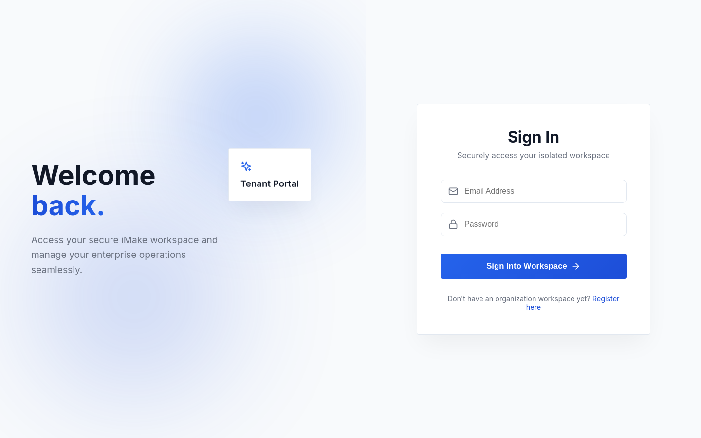

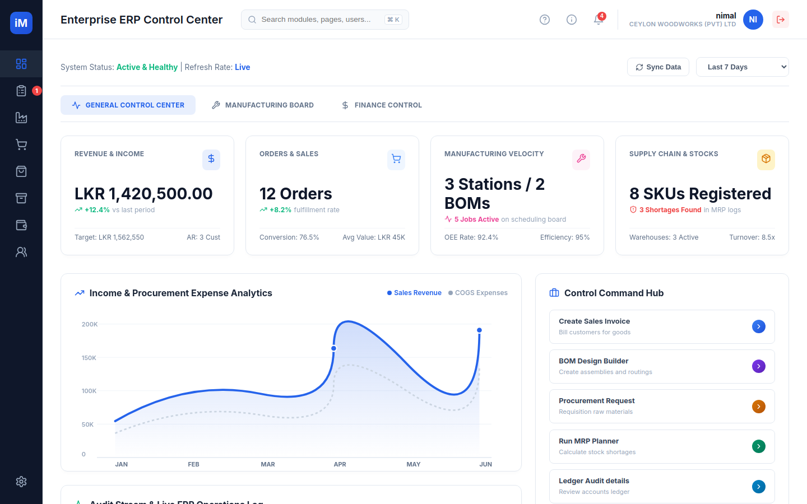

## 2. Master data

**Purpose.** Check items, customers, suppliers, and the stores.

**SRS.** MM-01, MM-02, MM-03, SCP-02, SCP-03

1. Sign in as Nimal.
2. Open **Production → Products**. You should see teak, screws, varnish, fabric, glue, the dining chair, and the side table.
3. Open **Sales → Customers**. Galle Heritage Hotel has a large credit limit. Kandy Cafe Co has a small one. Factory cash counter is cash only.
4. Open **Purchases → Suppliers**. Kelani Timber, Colombo Hardware, and Elakanda Contract Packers are there.
5. Open **Stock → Warehouses**. MAIN is the raw store, FG-01 is finished goods, SUB-01 is the contract floor, VAN-01 is the van.

**Expected.** Codes are unique. The chair and the table have a bill of materials. Kilogram is available as a unit.

- [ ] Pass
- [ ] Fail

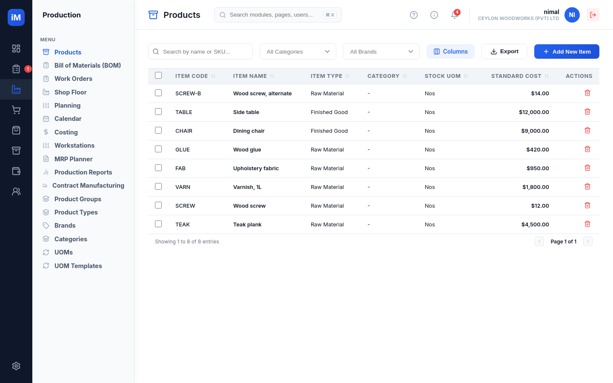

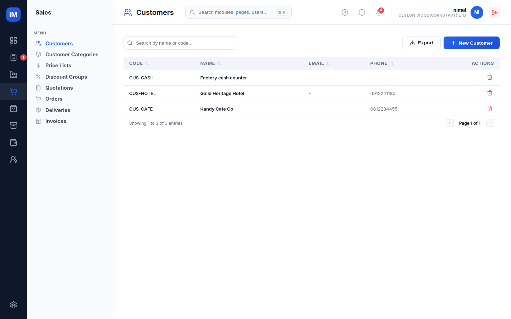

## 3. Purchase: requisition to payment

**Purpose.** Follow a buy from request to payment, including a second person approving it.

**SRS.** PR-01, PR-02, PR-04, PR-06, WF-01, WF-02, INV-03

1. As Nimal, open **Purchases → Purchase Requisitions**. One requisition is already waiting: extra teak for LKR 9,000.
2. Sign out. Sign in as Kamani. Open **Approvals**. Approve that requisition. A reason is required only when you return or reject.
3. Sign back in as Nimal. Open **Purchases → RFQs**. The teak request already has two quotes. Kelani Timber was selected because the price and lead time were better.
4. Open **Purchase Orders**, **GRNs**, **Landed Cost**, and **Supplier Invoices**. The varnish receipt is already there, with freight added and the supplier invoice matched.
5. To try a new one: **Purchase Requisitions → New**, add a line, save. It stays pending until Kamani approves it. Then raise the purchase order, receive it on a GRN with a lot and a bin, add landed cost, and match the supplier invoice.
6. Pay it from **Finance → Payment Vouchers**. Kamani must approve the payment before it posts.

**Expected.** Nimal cannot approve his own requisition. After approval the document can move on. The goods receipt increases stock. Freight is added to the item cost. The supplier invoice clears the goods-received-not-invoiced balance.

- [ ] Pass
- [ ] Fail

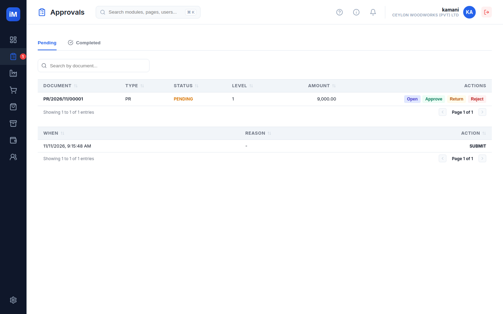

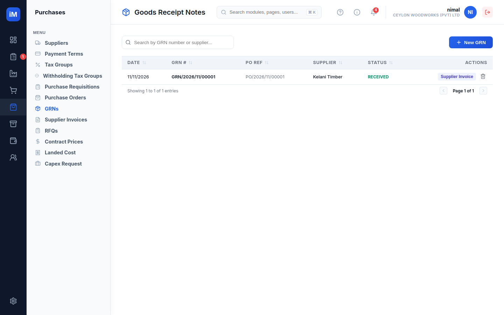

## 4. Quote to cash

**Purpose.** Sell a chair: quote, order, delivery, invoice, and money in.

**SRS.** SL-01, SL-02, SL-05, FN-03

1. Open **Sales → Quotations**. One quote for Galle Heritage Hotel is already approved.
2. Open **Orders**. The hotel chair order is delivered. The side-table order is still open (that one is made to order).
3. Open **Deliveries** and **Invoices**. The hotel invoice is still unpaid, apart from a small credit note.
4. Open the hotel invoice and use **Receive payment**, or open **Finance → Payment Receipts → New** and allocate the invoice.
5. To test credit hold: as Nimal, create an order for **Kandy Cafe Co** for two dining chairs. The cafe limit is LKR 20,000, so the order waits for approval.
6. Sign in as Kamani, open **Approvals**, and approve the credit release. The order can then be delivered.

**Expected.** An order over the credit limit is not released until Kamani approves it. Delivery reduces finished-goods stock. The invoice shows on customer outstanding until the receipt is allocated.

- [ ] Pass
- [ ] Fail

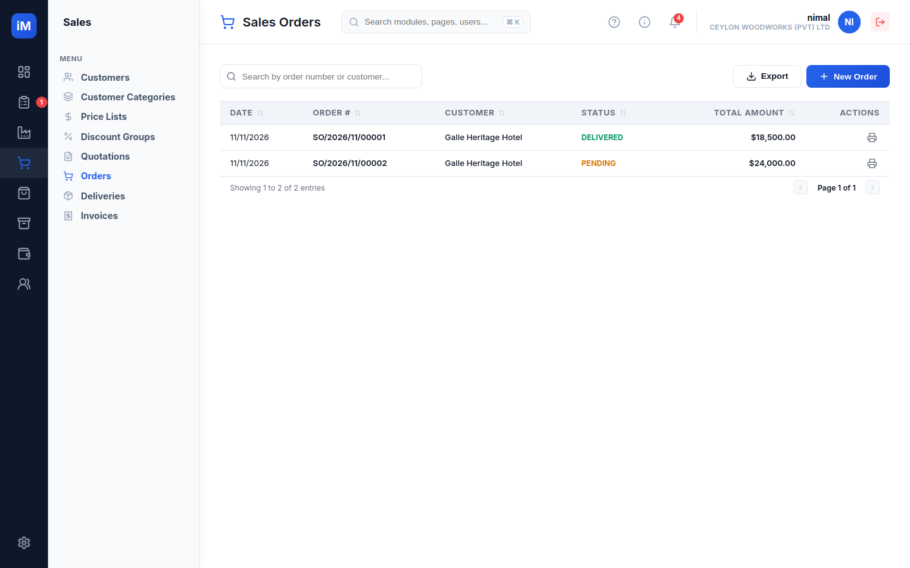

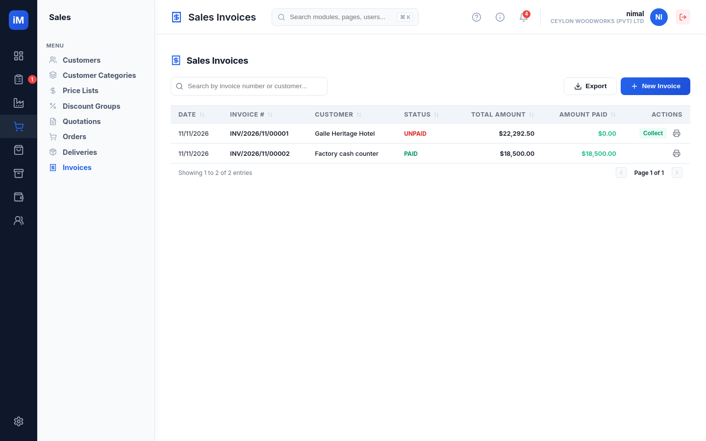

## 5. Van and cash sale

**Purpose.** Sell for cash at the counter or from the van.

**SRS.** SL-04

1. Open **Sales → Invoices**. Find the invoice for **Factory cash counter**. It is paid.
2. Open **Finance → Payment Receipts**. The matching cash receipt is there.
3. To do another one: create an invoice for Factory cash counter, choose the finished-goods warehouse, save it as issued, then take a cash receipt for the full amount.

**Expected.** The invoice goes to Paid. Stock of the chair goes down. Cash on Hand goes up. There is no separate van document.

- [ ] Pass
- [ ] Fail

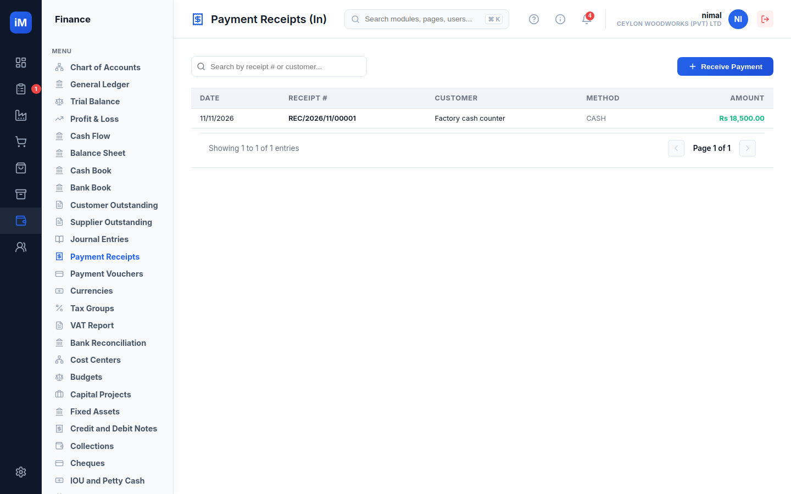

## 6. Returns both ways

**Purpose.** Take a customer return and send goods back to a supplier.

**SRS.** INV-09, SL-05

1. Open **Stock → Returns**.
2. One line is a customer return (goods return advice) for a chair that was not accepted. It sits in quarantine and is not available to sell.
3. The other line is a supplier return for a leaking tin of varnish. That quantity has left the store.
4. To add one: **New**, choose Market, Damage, GRA, or Supplier, enter the item, quantity, and a reason, then post.

**Expected.** A customer return does not go back into free stock. A supplier return reduces on-hand stock.

- [ ] Pass
- [ ] Fail

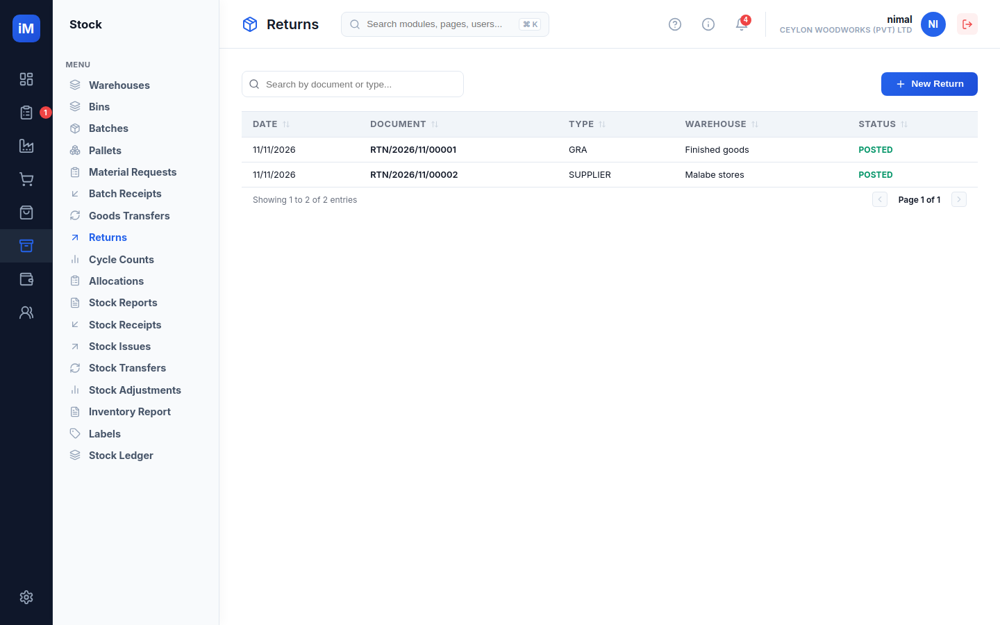

## 7. Material request, issue, and transfer

**Purpose.** Ask for stock, pick it, issue it, and move some to another store.

**SRS.** INV-04, INV-05, INV-08

1. Open **Stock → Material Requests**. The assembly request for screws is already fulfilled. Open it to see the pick list.
2. Open **Goods Transfers**. One tin of varnish is in transit from MAIN to FG-01. Open it and press **Receive**.
3. To try a new request: **Material Requests → New**, choose Issue, the assembly team, MAIN, and a small quantity of screws. Approve it, build the pick list, then fulfil it.

**Expected.** You cannot fulfil more than the request. An in-transit transfer is not available at the destination until it is received. The pick list suggests the oldest lot.

- [ ] Pass
- [ ] Fail

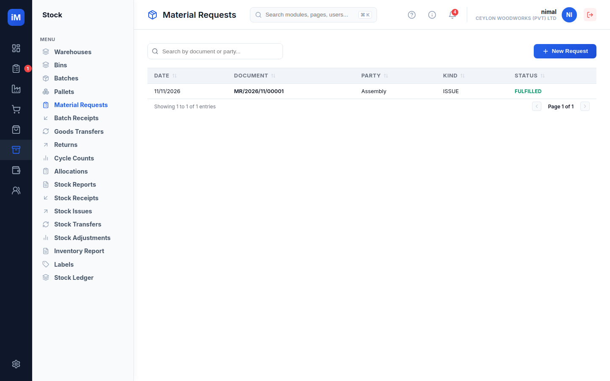

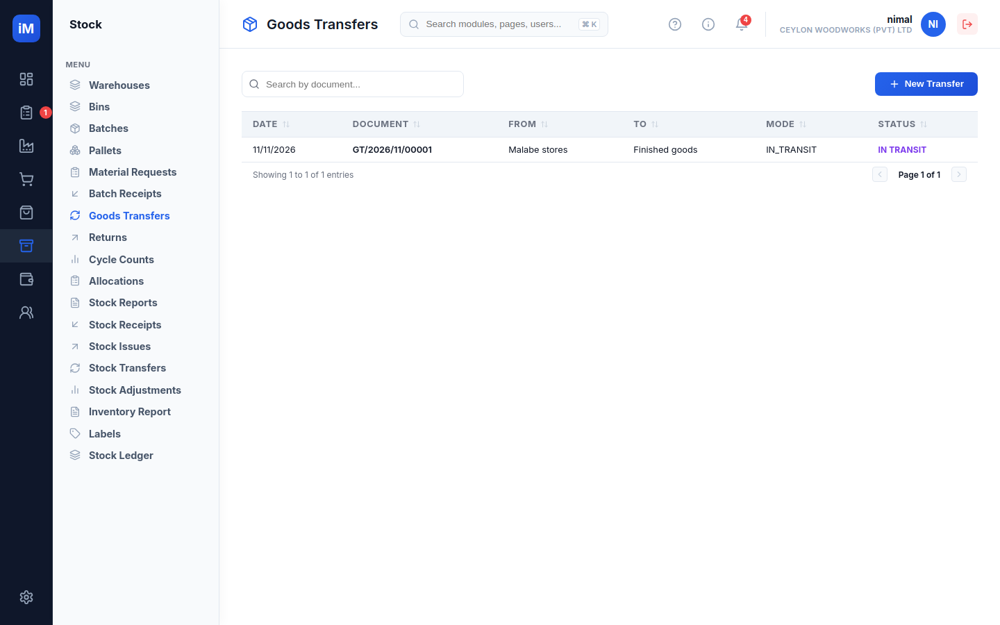

## 8. Cycle count

**Purpose.** Count the shelf and post the difference only after approval.

**SRS.** INV-11

1. Open **Stock → Cycle Counts**. The screw count is already posted (two boxes short).
2. Start a new count: **New**, warehouse MAIN, enter a physical quantity that differs from the book, and a reason.
3. With approvals on, the difference waits for Kamani. After approval, post it.
4. Open **Stock → Stock Reports**, choose **Count variance**, and export the sheet.

**Expected.** The book quantity and the counted quantity are both stored. Stock and the ledger change only after the count is approved and posted.

- [ ] Pass
- [ ] Fail

## 9. Weekly plan and a work order

**Purpose.** Plan the week, release a work order, confirm the shop floor, and close it.

**SRS.** PD-01, PD-02, PD-04, PD-05, PD-06

1. Open **Production → MRP Planner**. Press **Run**, then open the **MPS** tab. Firm a planned chair order if you want a new work order.
2. Open **Work Orders**. One chair batch is created and waiting. The side table is a draft from the sales order.
3. Open the chair batch and press **Release**.
4. Press **Shop floor**. Confirm each step (cut, assemble, finish) with the good quantity.
5. When the full quantity is confirmed, use **Close now**. If you made fewer than ordered, use **Short close**.
6. Open **Production → Production Reports** and look at the variance.

**Expected.** Release warns if material is short but still releases. Confirming the last step receives the finished chairs. Close now is refused until the full quantity is received.

- [ ] Pass
- [ ] Fail

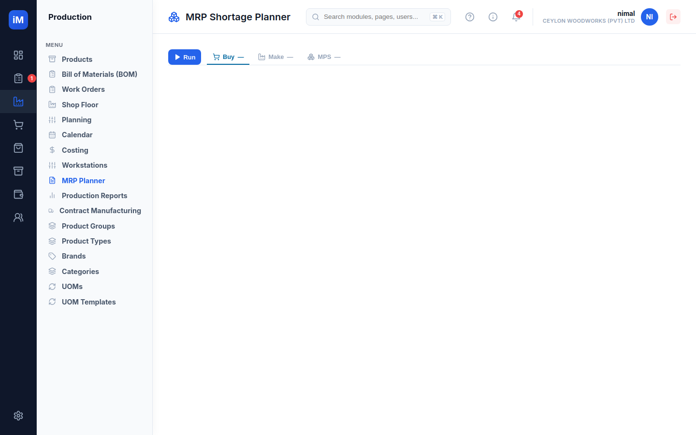

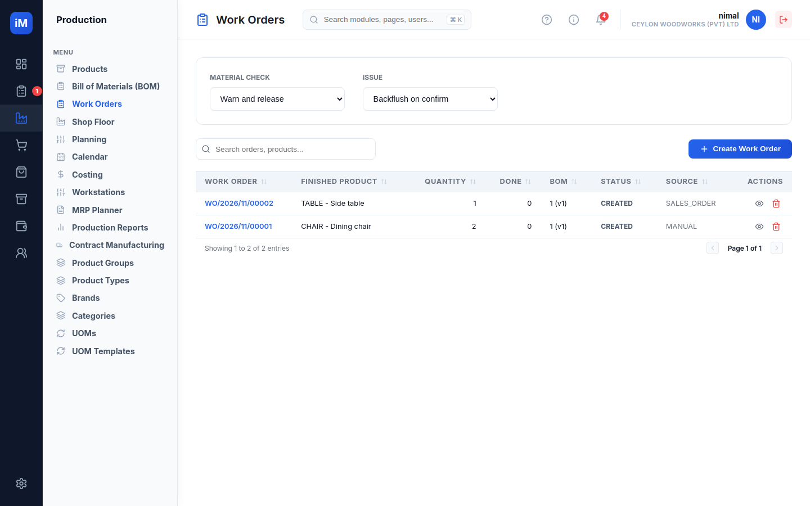

## 10. Make-to-order sales order

**Purpose.** A side table is not kept in stock. The sales order should raise a draft work order.

**SRS.** PD-02, SL-01

1. Open **Sales → Orders** and open the side-table order for Galle Heritage Hotel.
2. Open **Production → Work Orders**. A draft work order for that table is linked to the order.
3. To try another: create a sales order for one side table. A new draft work order appears.

**Expected.** The dining chair (make to stock) does not get a work order from the sales order. The side table does.

- [ ] Pass
- [ ] Fail

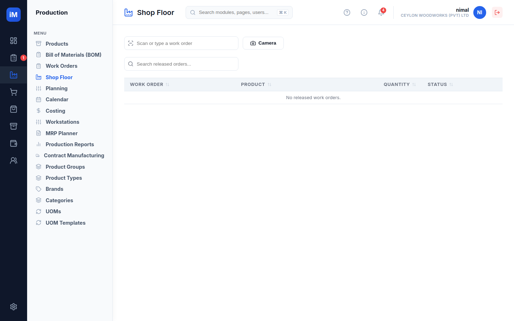

## 11. Contract manufacturing

**Purpose.** Send work to Elakanda and receive it back at the virtual floor.

**SRS.** SCP-03, INV-03, PD-01

1. Open **Production → Contract Manufacturing**.
2. The draft order is for two dining chairs at SUB-01, finished goods back to FG-01, with a service charge.
3. Open it and issue teak from MAIN, receive the chairs, then post the service charge.

**Expected.** SUB-01 is a virtual warehouse tied to Elakanda Contract Packers. Issued material leaves MAIN. Received chairs land in finished goods.

- [ ] Pass
- [ ] Fail

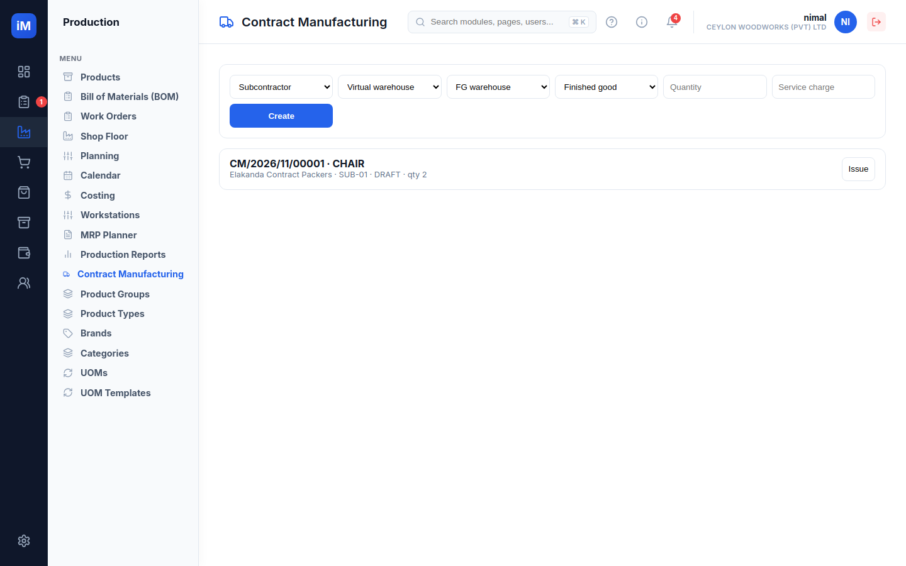

## 12. Abnormal loss

**Purpose.** A loss above the allowed scrap needs a manager before it hits the loss account.

**SRS.** PD-07

1. Open a dining chair product. The abnormal-loss threshold is 2 percent. Scrap standards are on **Product Groups** (Furniture 2 percent, Soya 2, Pasta 3, Sauce 1.5).
2. On a released work order, confirm a finish step with scrap above that threshold and choose a scrap reason.
3. Open **Production → Production Reports** and review the variance.

**Expected.** Normal scrap stays in the production variance. There is no separate loss-approval screen in this build. See the limitations at the end.

- [ ] Pass
- [ ] Fail

## 13. Capex, CWIP, asset, and depreciation

**Purpose.** A packing line is bought as capital, held as work in progress, then turned into an asset and depreciated.

**SRS.** PR-03, PR-06, FN-06

1. Open **Finance → Capital Projects**. PACK-1 is the packing line, budget LKR 2,500,000.
2. Open **Finance → Fixed Assets**. CWIP-PACK is already an active asset (capitalized from the deposit).
3. The November depreciation run has been posted. Accumulated depreciation shows on the trial balance.
4. To try a new one: **Purchases → Capex Request**, choose project PACK-1, and save. Kamani approves capital requests. After the goods receipt, capitalize the asset from the asset screen and run depreciation for an open month.

**Expected.** The capitalization threshold in finance settings is LKR 100,000. Capital spend needs a project. Depreciation uses exact days in the month.

- [ ] Pass
- [ ] Fail

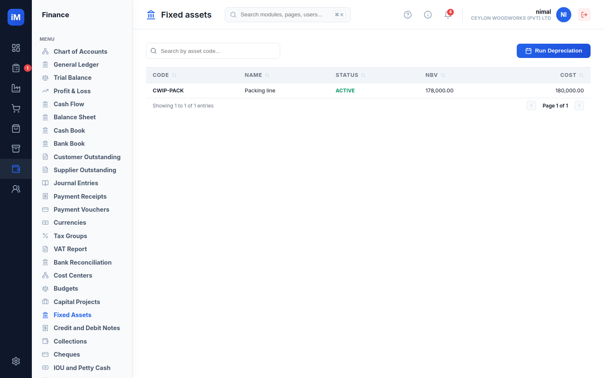

## 14. Credit notes, debit notes, IOU, and the bank

**Purpose.** Adjust an invoice, track an employee advance, and match the bank.

**SRS.** FN-03, FN-04, FN-05

1. Open **Finance → Credit and Debit Notes**. A customer credit note for LKR 1,000 is posted against the hotel (reason RETURN).
2. Open **Cheques**. Cheque CHQ-4401 is unrealised (money not in the bank yet).
3. Open **IOU and Petty Cash**. The Malabe tin was funded, and Kumari Silva has an open advance. Open it and settle part of it to an expense account.
4. Open **Bank Reconciliation**. A draft November statement is there, including the packing-line payment. Match the line to the ledger, or import a CSV, then finalize.
5. A supplier withholding-tax certificate is available from a posted payment voucher when WHT applies. WHT is calculated at payment. SVAT is off.

**Expected.** A credit note reduces what the customer owes. An IOU stays open until it is settled. An unrealised cheque is not the same as cash in the bank.

- [ ] Pass
- [ ] Fail

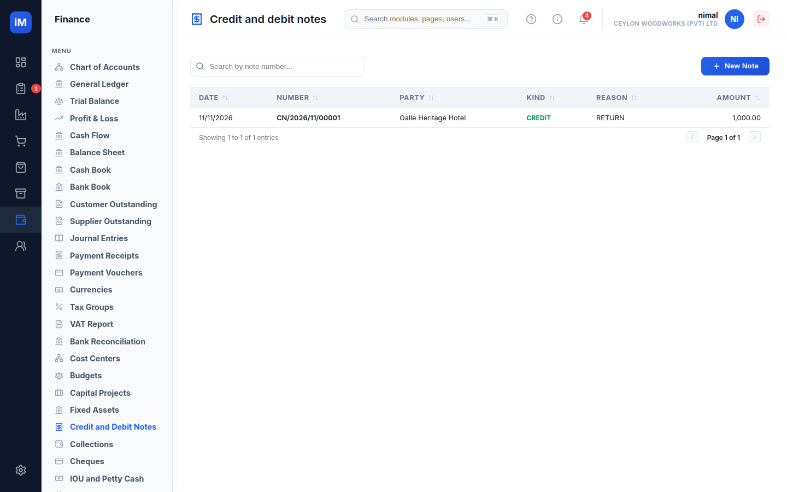

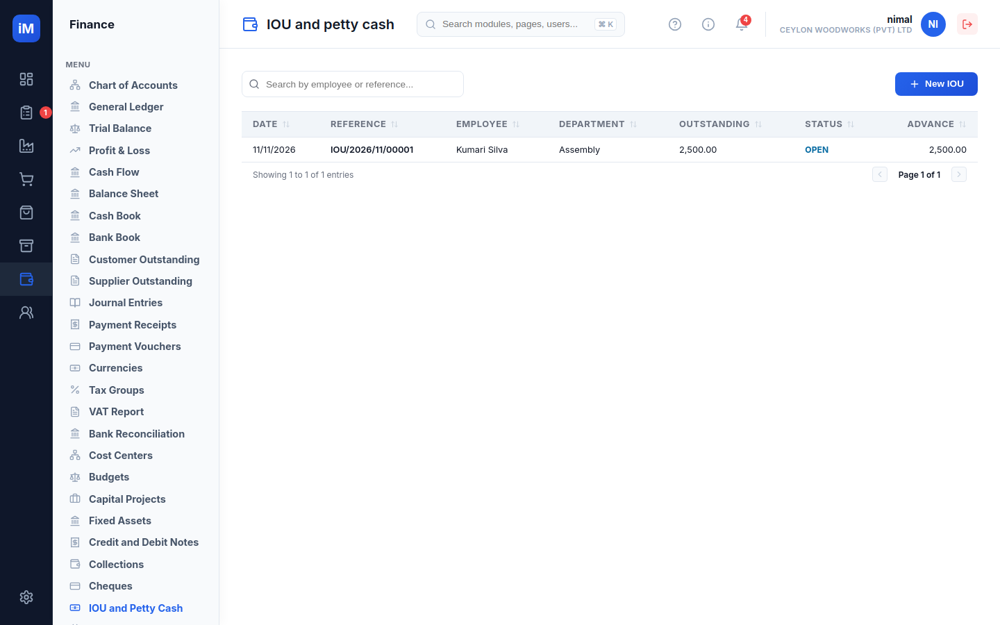

## 15. Month-end and a locked period

**Purpose.** Close the books in order, then prove a closed month cannot be posted to.

**SRS.** FN-01, FN-02, WF-04

1. Open **Settings → Fiscal periods**. Year 2026. **Allow negative stock** is off. October 2026 is Closed. November 2026 is Open.
2. Open **Finance → Journal Entries → New**. Date it 15 October 2026 and try to post a balanced entry. The system refuses it.
3. Open **Finance → Period Close**. Open November if it is not listed. Tick the steps in order: Inventory, Production, Accounts payable, Accounts receivable, Cash and bank, Fixed assets, then General ledger.
4. Post the closing entries only after those steps are done. The month then rejects every new posting.
5. Try to issue stock that would go below zero. With the box unticked, the system blocks it.

**Expected.** October rejects the journal even though journals need approval. November still accepts a balanced journal, which then waits for Kamani.

- [ ] Pass
- [ ] Fail

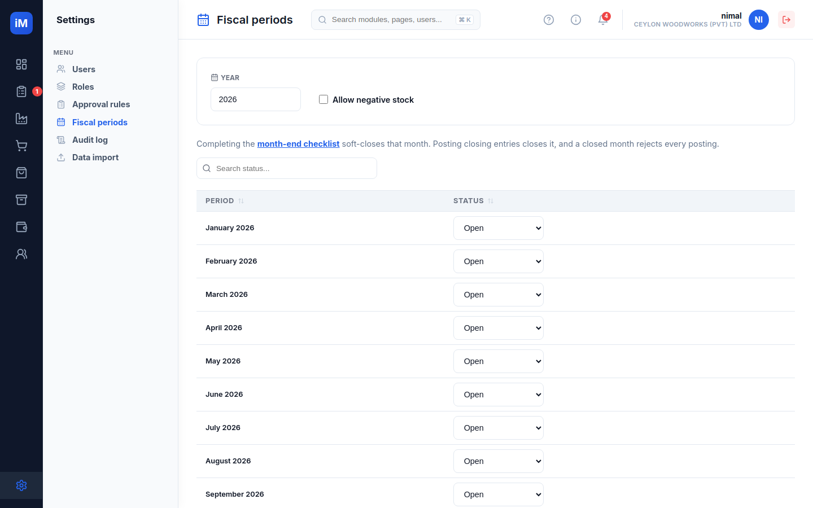

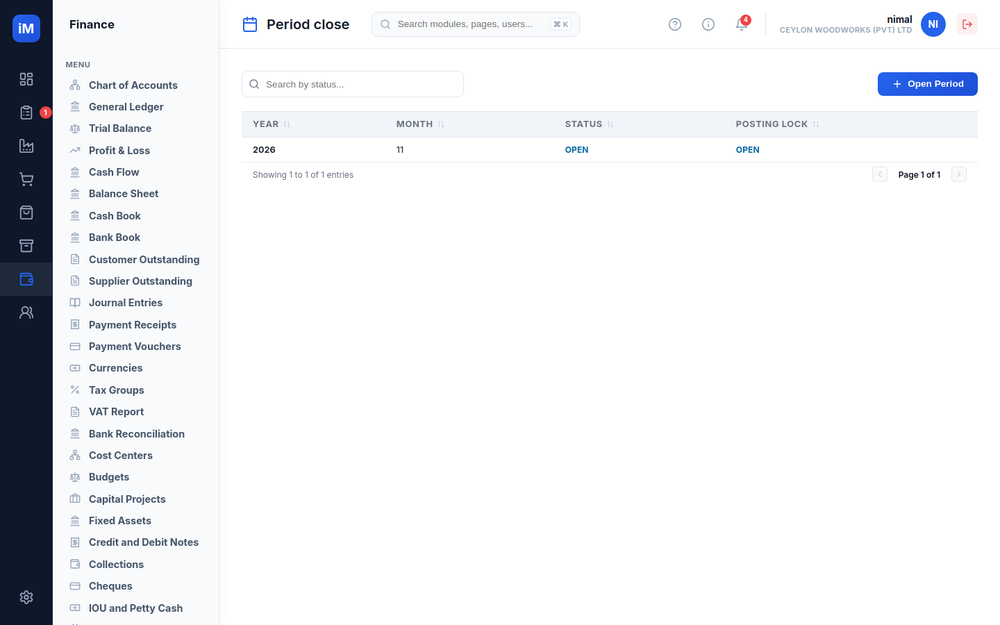

## 16. Audit history

**Purpose.** See who did what.

**SRS.** WF-04, NFR-02

1. Open **Settings → Audit log**.
2. Filter by entity or date. Opening stock, the credit note, the approvals, and the period change are listed.
3. Export the sheet if you need to send it.

**Expected.** Each row shows the action, the document, the person, and the time. Posted documents are corrected by reversal, return, or credit note, not by deleting the history.

- [ ] Pass
- [ ] Fail

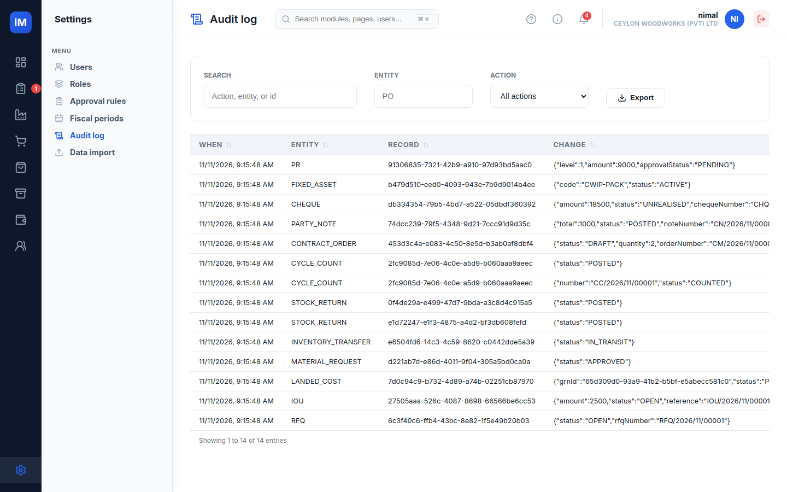

## 17. Reports and the trial balance

**Purpose.** Check that the books balance and that every finance and stock report exports to Excel.

**SRS.** RPT-01, RPT-02, INV-02, FN-01

1. Open **Finance → Trial Balance**. Total debit and total credit are both **350,200.50**. The green line says debits equal credits. Each account is on one side only.
2. Press **Export**. The file is an Excel sheet with one header row.
3. Open **Finance → Finance Reports**. Pick each report (profit and loss, balance sheet, ageing, GRNI, stock valuation, asset register, VAT, and the rest). Press **Export XLSX**.
4. Open **Stock → Stock Reports**. Switch among stock position, movement, ageing, and count variance. Press **Export XLSX**.
5. Open **VAT Report** and **Profit & Loss** and use their export or print buttons.

**Expected.** The trial balance stays equal after the documents in this guide. Excel files open in a spreadsheet. Print uses the browser print dialog.

- [ ] Pass
- [ ] Fail

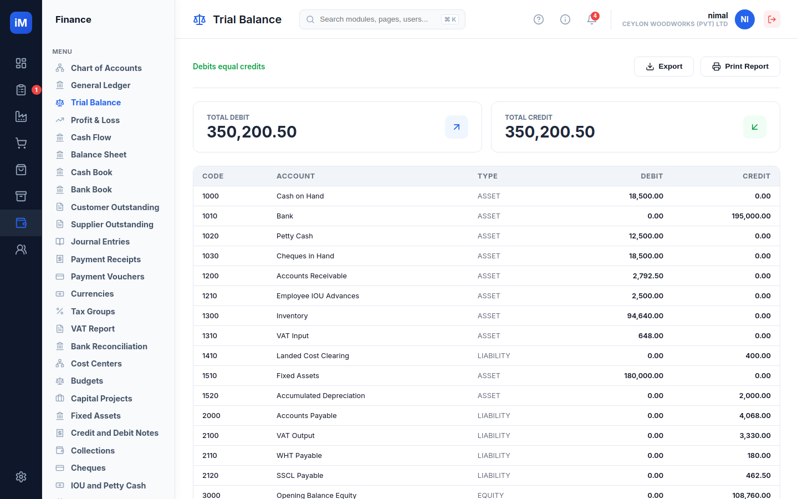

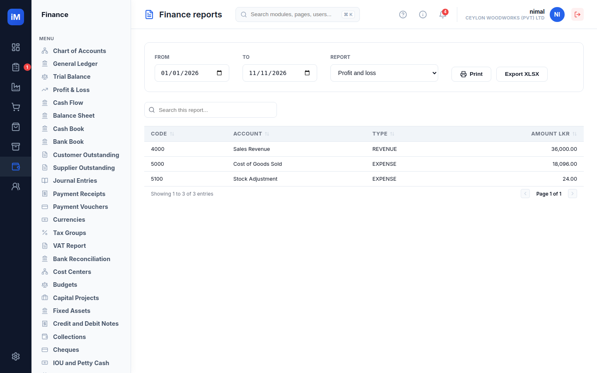

## Defaults chosen where the SRS said “confirm”

| Topic | Demo choice |
| --- | --- |
| Currency | LKR for the books. USD is loaded at 305. No other currencies. |
| Tax | VAT and WHT groups exist. WHT is taken at payment. SVAT is off. |
| Capital threshold | LKR 100,000. A capital request needs project PACK-1. |
| Price tolerance | 2 percent against a contract price. |
| Approvals | On for requisitions, capital requests, purchase orders, supplier payments, journals, credit and debit notes, stock adjustments, cycle counts, material requests, price overrides, and credit release. The maker cannot approve their own document. |
| Approval amounts | Purchase orders: LKR 50,000 then 250,000. Supplier payments: LKR 10,000 then 100,000. Other controlled documents: any amount. |
| Stock | Negative stock is blocked. Valuation is FIFO and cannot be switched. |
| Credit | Over-limit or overdue orders wait for Kamani. |
| Periods | October 2026 is closed. November 2026 is open. |
| Yield and scrap | Furniture 98 / 2. Soya 97 / 2. Pasta 96 / 3. Sauce 98 / 1.5. Abnormal loss starts at 2 percent. |
| Planning | Eight-week horizon. Labour LKR 650 an hour. Overhead 10 percent of conversion. Close grace is 3 days. |
| Stores | MAIN raw store, FG-01 finished goods, SUB-01 contract floor, VAN-01 van. Bins: BIN-A1, QA-HOLD, DMG-01. |
| Cost centres | Soya, Pasta, Sauce, Turkey Import, Contract Manufacturing, and Administration. Administration is split 20 percent to each operation. |

## Known limitations

- The iForce SFA link was dropped. There is no gate pass, trip sheet, proof of delivery, or vehicle load list. Dispatch is the delivery note. A cash or van sale is an invoice plus a cash receipt. Pick lists are built from material requests.
- Abnormal loss has a threshold on the item and a report, but no separate approval screen.
- The home-screen tiles (revenue, order counts, the chart) are sample figures. Use the trial balance and the registers for real numbers.
- Human resources screens are in the menu. Payroll is outside the signed SRS.
- Excel export is on the finance report catalogue, the trial balance, the audit log, and the stock reports. Batch trace is print only.
- Document deletes ask in the iMake confirm dialog, not a browser popup.
